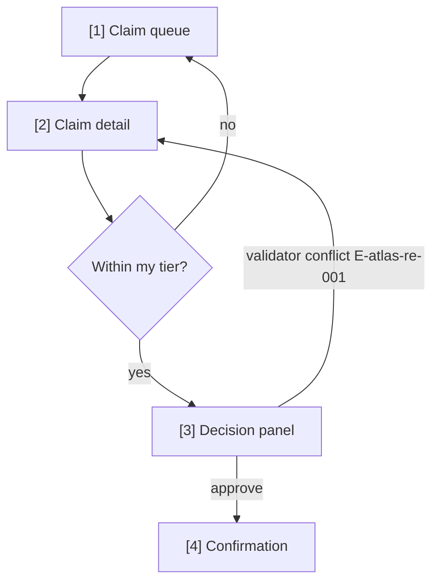

# ANGENT BA: user-flow

Maintained adaptation from MIT Dev BA Kit (copyright 2026 Edward Ngo): https://github.com/nv-minh/dev-ba-kit/blob/main/skills/user-flow/SKILL.md

## Portability and authority

Use domain-specific steps below as methodology, not as authority or proof of tool execution. Original Claude-specific scripts, hooks, subagents, filesystem paths and approval levels are illustrative until verified in the current environment. ANGENT Root owns intent and routing; Execution owns writes and read-back; Quality verifies outcomes. Honor project naming and do not invent decisions.


# /user-flow — Screen navigation map (the source of flow division)

## Goal

Map the feature into **flows** (flow-slug + the screens each contains) and draw the navigation per flow — Mermaid `flowchart` with screens numbered `[n]`, covering happy, error, and edge paths. **Single output**: `docs/{feature}/srs/{feature}-userflow.md` (type `srs-userflow`). `ascii-wireframe/` and `html-wireframe/` (wave 3) read THIS file to know which screens each flow contains — no other source of flow division exists.

## Constraints

- **1 fixed output** — `docs/{feature}/srs/{feature}-userflow.md`. Slim frontmatter `type`/`feature`/`updated` + state fields `stage`/`flow_approved_at`/`flow_hash`/`primary_device` (`naming-conventions.md`).
- **Group A, handles itself** (`feature-bootstrap.md`) — accepts a slug OR a free-form description; infer mode + clarify; new feature → derive slug + create.
- **Device question FIRST** (`ba-conventions.md` §7) — mobile 375 / tablet 768 / desktop 1024 decides layout thinking; recorded as `primary_device`. Ask once, never re-ask.
- **Screens are numbered `[n]` and named** — `[1] Claim queue`, `[2] Claim detail`… Numbers are stable across re-runs (new screens take the next number; removed screens retire theirs).
- **Every decision/error path lands somewhere** — an edge must end on a screen, a terminal state, or an explicit exit; dead-ends are BLOCKING per the flow's own review.
- **Flow division is deliberate** — group screens into flows by user intent (e.g. `approve-claim`, `review-history`), not by menu structure; 3-8 screens per flow; a 12-screen flow → split.
- **Sources** — UC files (MSS steps → screens), spec FRs (what surfaces must exist), URD context; else interview. No fabricated screens: every screen traces to a step/FR/answer.
- **Approval stamps state** — on user approval set `stage: approved`, `flow_approved_at: {date}`, `flow_hash` (sha of the flow list) — wireframe skills gate on these.
- **Render-verify MANDATORY** — mermaid-verify after Write (step 9).
- **Validate before done** — doc-validate (step 9.5).

## Inputs

```
/user-flow <feature>                       # derive flows from UC/spec
/user-flow <feature> "<description>"       # explicit navigation description
/user-flow <new-feature> "<description>"   # group A: create feature
```

## Approach

1. **Resolve feature + read sources.** UCs (MSS steps + extensions → screen/edge candidates), spec (FRs → required surfaces, E- rows → error paths), URD (device hints).
2. **Ask the device question** (if `primary_device` not already set) + clarify gaps: entry points · what the user sees first · where each error path lands.
3. **Fact-list** — screen candidates with sources · flow grouping proposal · every decision/error edge and its destination.
4. **Draft** — frontmatter + one `## Flow: {flow-slug}` section per flow, each with its screen list (`[n] Name — one-line purpose`) and a Mermaid `flowchart TD` (screens as nodes `S1["[1] Claim queue"]`, decisions as diamonds, error paths labeled with E- codes where known).
5. **Self-check** — no dead-ends; every screen reachable from an entry; numbering has no gaps/duplicates.
6. **L1 plan preview** — flow list + screen count + device + edge coverage.
8. **On approval, stamp state** — `stage: approved` + `flow_approved_at` + `flow_hash`.
9.5. **Flow_Reviewer gate (ONLY when over the complexity threshold)** — if the file has **≥3 flows**, OR **≥8 screens total**, OR **any single flow with >1 error/decision path**, spawn an agent via the Task tool, `subagent_type: flow-reviewer`, passing: the `## Flow:` section(s) just written + the step-3 fact-list (screen candidates with sources, decision/error edges + destinations). Measure by **total complexity** — screen count alone is not enough (a 4-screen straight line is simple; a 4-screen flow with 3 error branches is complex). Below every threshold, step 5's self-check (no agent) is enough — SKIP 9.5, go straight to step 10.
   - **Task tool unavailable** (not provided by the runtime) → do NOT implicitly treat it as reviewed; the report states `reviewer skipped (Task unavailable)` so the user knows a complex flow did not pass the gate.
   - Receive findings (format `review-format.md` + a "Coverage checklist" section). Any BLOCKING (a missing screen / a dead-end / a single-branch gateway) → add the missing screen or destination, re-run render-verify (9) + self-check (5), then continue. Loop at most 2 rounds; round 2 still BLOCKING → report the outstanding findings, let the user decide before the final report.
   - Verdict `approve`/only WARNING/SUGGESTION → continue straight to step 10, no fix needed.
10. **Output report** — flows + screens + next (wave 3 wireframes read this file).

## Mermaid shape reference (Claude composes it, do NOT hard-paste)



## Gotchas

- **Navigation, not process** — lanes/roles belong to `/activity-swimlane`; this diagram is what the USER sees, screen to screen.
- **Stable numbers are the contract** — wireframe files deep-link `id="s{n}"`; renumbering breaks them. Retire, don't reuse.
- **Error paths deserve screens** — "show an error" is not a destination; decide whether it's a state of the same screen or its own screen.
- **The hash is not decoration** — wave-3 skills compare `flow_hash` to detect a stale division; skipping the stamp breaks their gate.
